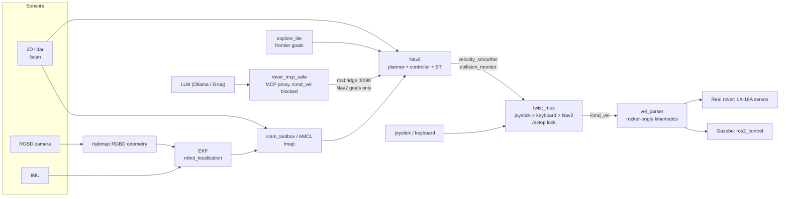

# rover_circ_ares

[](https://github.com/Blazemorales/rover_circ_ares/actions/workflows/docker-build.yml)
[](https://github.com/Blazemorales/rover_circ_ares/actions/workflows/tests.yml)
[](https://github.com/Blazemorales/rover_circ_ares/actions/workflows/python-formatter.yml)
[](https://github.com/Blazemorales/rover_circ_ares/actions/workflows/cpp-formatter.yml)
[](https://blazemorales.github.io/rover_circ_ares/)

**English** · [Português](README.pt-BR.md)

This is the official repository from ARES - UnB for ROS 2, aimed at the
[Canadian International Rover Challenge (CIRC)](https://circ.cstag.ca/).
It runs a Sawppy-style rocker-bogie rover in Gazebo with SLAM, autonomous
exploration and Nav2 tuned for uneven terrain, and it can take missions in
natural language through MCP and a web chat.

- ROS 2 Jazzy · Gazebo Harmonic · Nav2 · slam_toolbox · explore_lite · rosbridge
- Documentation site: <https://blazemorales.github.io/rover_circ_ares/>
- What is still missing for CIRC: [requirements checklist](https://blazemorales.github.io/rover_circ_ares/requisitos-circ/)
  and the tracking issue [#26](https://github.com/Blazemorales/rover_circ_ares/issues/26)

<div align="center">
  
</div>

## For judges: where to find what

| I want to see… | Go to |
|---|---|
| What the rover does and how the software fits together | [Architecture](#architecture) below |
| How to build and run it from a clean machine | [Essential commands](#essential-commands) (Docker only, nothing else on the host) |
| Proof that it builds and the safety tests pass | [Actions](https://github.com/Blazemorales/rover_circ_ares/actions): Docker build, tests, formatting |
| ROS 2 source code | [`ros2/`](ros2/), one colcon package per function (table below) |
| Autonomous navigation tuning | [`ros2/rover_navigation/params/`](ros2/rover_navigation/params/), [`behavior_trees/`](ros2/rover_navigation/behavior_trees/) |
| Natural-language missions (LLM) and their safety layer | [`tools/`](tools/) and the [ROS-MCP page](https://blazemorales.github.io/rover_circ_ares/ros-mcp/) |
| Engineering log: decisions, bugs, measurements | [Engineering log](https://blazemorales.github.io/rover_circ_ares/diario-de-bordo/) |
| Status against the CIRC rules | [CIRC requirements checklist](https://blazemorales.github.io/rover_circ_ares/requisitos-circ/) |

## Architecture



- **Localization:** visual odometry from the RGBD camera fused with the IMU
  in an EKF; slam_toolbox builds the map (or AMCL localizes on a saved one).
- **Navigation:** Nav2 with costmaps tuned for terrain without walls
  (`uneven_terrain`), a behavior tree that replans and retries, and
  explore_lite for autonomous frontier exploration.
- **Actuation:** `vel_parser` turns `/cmd_vel` into steering and wheel
  commands for the rocker-bogie; the same nodes drive Gazebo or the real
  LX-16A servos.
- **AI layer:** an LLM can only send navigation goals and read state through
  a restricted MCP proxy. It never publishes velocities.

### Simulation worlds

| Moon (main test world) | Mars | Forest |
|---|---|---|
|  |  |  |

## Repository layout

| Path | Contents |
|---|---|
| `ros2/` | Everything that runs the rover: the colcon packages and the boot service |
| `ros2/rover_bringup` | Entry-point launch files (real rover, simulation + rosbridge) |
| `ros2/rover_description` | URDF/xacro model and sensors |
| `ros2/rover_gazebo` | Worlds (moon, mars, forest...), bridges and simulation nodes |
| `ros2/rover_navigation` | Nav2 parameters and behavior tree |
| `ros2/rover_slam`, `ros2/rover_localization` | slam_toolbox / AMCL / exploration, EKF and rtabmap |
| `ros2/rover_motor_controller(_cpp)` | LX-16A servo driver (Python and C++) |
| `ros2/rover_teleop`, `ros2/rover_msgs` | Joystick/keyboard teleop, custom messages |
| `ros2/explore_lite(_msgs)` | Vendored frontier exploration |
| `ros2/rover_service` | systemd service that starts the real rover at boot |
| `tools/` | MCP proxy (`rover_mcp_safe`), web chat (`rover_web`), RTF meter |
| `docs/site/` | Documentation site (Hugo), published at <https://blazemorales.github.io/rover_circ_ares/> |
| `docs/images/` | Images used by the READMEs |
| `.github/workflows/` | CI: Docker build, offline tests, formatting, docs and API deploy |
| `Dockerfile`, `.devcontainer/` | Reproducible environment (ROS 2 Jazzy + Gazebo Harmonic) |
| `render.yaml` | Render blueprint for the web chat (must stay at the root) |

## Essential commands

ROS is not installed on the host on purpose: everything runs inside a Docker
container with the repository mounted as the workspace source.

### 1. Build the image and create the container

```bash
git clone https://github.com/Blazemorales/rover_circ_ares.git
cd rover_circ_ares                   # repository root (where the Dockerfile is)
docker build -t rover:latest .

docker run -d --name rover_mcp --net=host \
  -v "$(pwd)":/root/ros2_ws/src rover:latest sleep infinity
docker exec rover_mcp bash -lc 'cd /root/ros2_ws && colcon build --symlink-install'
```

### 2. Open a shell in the container

```bash
docker start rover_mcp               # if it is stopped (see docker ps -a)
docker exec -it rover_mcp bash       # the workspace is already sourced
```

### 3. Run the simulation

```bash
ros2 launch rover_bringup rover_mcp_sim.launch.py \
  slam:=true explore:=false headless:=true launch_rviz:=false sim_lite:=true
```

- `explore:=true` makes the rover explore on its own. Leave it `false` when
  sending goals, otherwise explore_lite preempts them.
- `headless:=true` runs Gazebo without a window. For the GUI, recreate the
  container with X11 (`-e DISPLAY -v /tmp/.X11-unix:/tmp/.X11-unix`) and run
  `xhost +local:docker` on the host.
- rosbridge starts after 5 s on port 9090.

| Argument | Default | What it does |
|---|---|---|
| `slam` | `True` | slam_toolbox (`True`) or AMCL on an existing `map` (`False`) |
| `explore` | `False` | Frontier exploration with explore_lite (needs `slam:=True`) |
| `headless` | `False` | Gazebo server only, no window |
| `launch_rviz` | `True` | Open RViz2 |
| `sim_lite` | `False` | Light camera profile (320x240 @ 10 Hz): roughly 2x faster simulation |
| `uneven_terrain` | `True` | Costmaps tuned for terrain without walls |
| `world` | `moon.world` | Gazebo world |
| `rosbridge` | `True` | Start rosbridge for MCP / web chat |

### 4. Check that it is up (another shell in the container)

```bash
ros2 topic echo /odom --once
ros2 action list | grep navigate_to_pose
ros2 service call /controller_manager/list_controllers controller_manager_msgs/srv/ListControllers
# the 3 controllers must be state='active'
```

### 5. Drive it

```bash
ros2 run rover_teleop teleop_keyboard_node            # keyboard
ros2 launch rover_teleop joy_teleop.launch.py         # PS3 joystick
```

### 6. Rebuild after changing code

```bash
docker exec rover_mcp bash -lc 'cd /root/ros2_ws && colcon build --symlink-install --packages-select rover_gazebo rover_bringup'
```

If packages move to another folder, clean first:
`rm -rf build install log` inside `/root/ros2_ws`, then build again.

### 7. Stop

Ctrl+C in the launch terminal. For a clean restart: `docker restart rover_mcp`.
**Never** use `pkill -f <pattern>` inside `docker exec bash -c "..."`: the
pattern matches its own command line and has already killed the container's
PID 1. Kill by PID instead:

```bash
ps -eo pid=,comm= | awk '$1 != 1 {print $1}' | xargs -r kill
```

### Other worlds

```bash
ros2 launch rover_gazebo moon.launch.py
ros2 launch rover_gazebo mars.launch.py
ros2 launch rover_gazebo forest.launch.py
```

The navigation stack is tuned and tested on the moon world; mars and forest
have not been revalidated recently.

### Real rover

```bash
ros2 launch rover_bringup rover.launch.py

# start it at boot as a systemd service
cd ~/ros2_ws/src/rover_circ_ares/ros2/rover_service
sudo ./install.sh
sudo service rover status
```

## Tests and CI

| Check | How | Where it runs |
|---|---|---|
| The workspace builds from scratch (rosdep + colcon) | `docker build -t rover:latest .` | CI on changes to `ros2/` or the `Dockerfile` |
| MCP proxy safety policy (`/cmd_vel` and lifecycle services refused) | `python -I tools/rover_mcp_safe/test_policy.py` | CI on changes to `tools/` |
| Python / C++ formatting | black (line length 90), clang-format 14 | CI on every push |
| ament lint tests | `colcon test` inside the container | Local |
| End-to-end navigation and LLM tests | see [`tools/README.md`](tools/README.md) | Local, against the simulation |

## Commanding the rover with AI

With the simulation running, an LLM can read the rover state and send Nav2
goals through a restricted MCP proxy (`/cmd_vel` is blocked), either from a
local chat (Ollama + `ollmcp`) or from a web page (Render + Groq, free tier).
Step-by-step guides:

- [ROS-MCP](https://blazemorales.github.io/rover_circ_ares/ros-mcp/): proxy, tools and local tests
- [Chat Web](https://blazemorales.github.io/rover_circ_ares/chat-web/): web chat and multi-step missions (`run_mission`)
- [Simulation performance](https://blazemorales.github.io/rover_circ_ares/desempenho-simulacao/): `sim_lite` and RTF measurements

## Dev Container (VS Code)

`.devcontainer/` sets up ROS 2 Jazzy, Gazebo and RViz2 with X11. Guide (in
Portuguese): [Dev Container](https://blazemorales.github.io/rover_circ_ares/dev-container/).

## Credits and citation

Based on [mgonzs13/ros2_rover](https://github.com/mgonzs13/ros2_rover), a ROS 2
version of [Sawppy the Rover](https://github.com/Roger-random/Sawppy_Rover).
MIT license.

Version `v0.7` of the upstream project was used in the paper *Comparison of
Concentric Surface Planetary Explorations Using an Ackerman Rover in a Lunar
Simulation* (iSpaRo 2024):

```bibtex
@INPROCEEDINGS{10685849,
  author={González-Santamarta, Miguel Á. and Rodríguez-Lera, Francisco J.},
  booktitle={2024 International Conference on Space Robotics (iSpaRo)},
  title={Comparison of Concentric Surface Planetary Explorations Using an Ackerman Rover in a Lunar Simulation},
  year={2024},
  volume={},
  number={},
  pages={239-244},
  keywords={Spirals;Navigation;Moon;Cameras;Sensors;Visual odometry;Testing},
  doi={10.1109/iSpaRo60631.2024.10685849}
}
```
