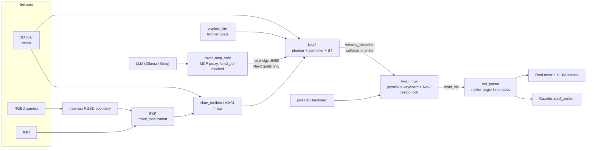

# rover_circ_ares

[](https://github.com/Blazemorales/rover_circ_ares/actions/workflows/docker-build.yml)
[](https://github.com/Blazemorales/rover_circ_ares/actions/workflows/tests.yml)
[](https://github.com/Blazemorales/rover_circ_ares/actions/workflows/python-formatter.yml)
[](https://github.com/Blazemorales/rover_circ_ares/actions/workflows/cpp-formatter.yml)
[](https://blazemorales.github.io/rover_circ_ares/)

[English](README.md) · **Português**

Este é o repositório oficial da ARES - UnB para o ROS2, voltado para a
[Canadian International Rover Challenge (CIRC)](https://circ.cstag.ca/).
Roda um rover rocker-bogie no estilo Sawppy no Gazebo, com SLAM, exploração
autônoma e Nav2 ajustado para terreno irregular, e aceita missões em linguagem
natural por MCP e por um chat web.

- ROS 2 Jazzy · Gazebo Harmonic · Nav2 · slam_toolbox · explore_lite · rosbridge
- Site da documentação: <https://blazemorales.github.io/rover_circ_ares/>
- O que ainda falta para o CIRC: [checklist de requisitos](https://blazemorales.github.io/rover_circ_ares/requisitos-circ/)
  e a issue de acompanhamento [#26](https://github.com/Blazemorales/rover_circ_ares/issues/26)

<div align="center">
  
</div>

## Para avaliadores: onde encontrar cada coisa

| Quero ver… | Onde está |
|---|---|
| O que o rover faz e como o software se encaixa | [Arquitetura](#arquitetura), logo abaixo |
| Como compilar e rodar a partir de uma máquina limpa | [Comandos essenciais](#comandos-essenciais) (só Docker, nada mais no host) |
| Prova de que compila e de que os testes de segurança passam | [Actions](https://github.com/Blazemorales/rover_circ_ares/actions): build do Docker, testes, formatação |
| Código-fonte ROS 2 | [`ros2/`](ros2/), um pacote colcon por função (tabela abaixo) |
| Ajustes da navegação autônoma | [`ros2/rover_navigation/params/`](ros2/rover_navigation/params/), [`behavior_trees/`](ros2/rover_navigation/behavior_trees/) |
| Missões em linguagem natural (LLM) e a camada de segurança | [`tools/`](tools/) e a [página ROS-MCP](https://blazemorales.github.io/rover_circ_ares/ros-mcp/) |
| Diário de engenharia: decisões, bugs, medições | [Diário de Bordo](https://blazemorales.github.io/rover_circ_ares/diario-de-bordo/) |
| Situação frente às regras da CIRC | [Checklist de requisitos CIRC](https://blazemorales.github.io/rover_circ_ares/requisitos-circ/) |

## Arquitetura



- **Localização:** odometria visual da câmera RGBD fundida com a IMU num EKF;
  o slam_toolbox monta o mapa (ou o AMCL localiza num mapa salvo).
- **Navegação:** Nav2 com costmaps ajustados para terreno sem paredes
  (`uneven_terrain`), behavior tree que replaneja e tenta de novo, e
  explore_lite para exploração autônoma de fronteiras.
- **Atuação:** o `vel_parser` converte `/cmd_vel` em comandos de direção e
  rodas do rocker-bogie; os mesmos nós acionam o Gazebo ou os servos LX-16A reais.
- **Camada de IA:** o LLM só manda goals de navegação e lê estado, por um
  proxy MCP restrito. Ele nunca publica velocidades.

### Mundos da simulação

| Lua (mundo principal de testes) | Marte | Floresta |
|---|---|---|
|  |  |  |

## Estrutura do repositório

| Caminho | Conteúdo |
|---|---|
| `ros2/` | Tudo o que opera o rover: os pacotes colcon e o serviço de boot |
| `ros2/rover_bringup` | Launch files de entrada (rover real, simulação + rosbridge) |
| `ros2/rover_description` | Modelo URDF/xacro e sensores |
| `ros2/rover_gazebo` | Mundos (moon, mars, forest...), bridges e nós da simulação |
| `ros2/rover_navigation` | Parâmetros do Nav2 e behavior tree |
| `ros2/rover_slam`, `ros2/rover_localization` | slam_toolbox / AMCL / exploração, EKF e rtabmap |
| `ros2/rover_motor_controller(_cpp)` | Driver dos servos LX-16A (Python e C++) |
| `ros2/rover_teleop`, `ros2/rover_msgs` | Teleoperação por joystick/teclado, mensagens próprias |
| `ros2/explore_lite(_msgs)` | Exploração de fronteiras (cópia vendorizada) |
| `ros2/rover_service` | Serviço systemd que sobe o rover real no boot |
| `tools/` | Proxy MCP (`rover_mcp_safe`), chat web (`rover_web`), medidor de RTF |
| `docs/site/` | Site da documentação (Hugo), publicado em <https://blazemorales.github.io/rover_circ_ares/> |
| `docs/images/` | Imagens usadas nos READMEs |
| `.github/workflows/` | CI: build do Docker, testes offline, formatação, deploy do site e da API |
| `Dockerfile`, `.devcontainer/` | Ambiente reproduzível (ROS 2 Jazzy + Gazebo Harmonic) |
| `render.yaml` | Blueprint do Render para o chat web (precisa ficar na raiz) |

## Comandos essenciais

O ROS não fica instalado no host, de propósito: tudo roda num container Docker
com o repositório montado como fonte do workspace.

### 1. Criar a imagem e o container

```bash
git clone https://github.com/Blazemorales/rover_circ_ares.git
cd rover_circ_ares                   # raiz do repositório (onde está o Dockerfile)
docker build -t rover:latest .

docker run -d --name rover_mcp --net=host \
  -v "$(pwd)":/root/ros2_ws/src rover:latest sleep infinity
docker exec rover_mcp bash -lc 'cd /root/ros2_ws && colcon build --symlink-install'
```

### 2. Abrir um terminal no container

```bash
docker start rover_mcp               # se estiver parado (veja com docker ps -a)
docker exec -it rover_mcp bash       # o workspace já vem com source feito
```

### 3. Subir a simulação

```bash
ros2 launch rover_bringup rover_mcp_sim.launch.py \
  slam:=true explore:=false headless:=true launch_rviz:=false sim_lite:=true
```

- `explore:=true` faz o rover explorar sozinho. Deixe `false` ao mandar goals,
  senão o explore_lite os preempta.
- `headless:=true` roda o Gazebo sem janela. Para ter a GUI, recrie o container
  com X11 (`-e DISPLAY -v /tmp/.X11-unix:/tmp/.X11-unix`) e rode
  `xhost +local:docker` no host.
- O rosbridge sobe 5 s depois, na porta 9090.

| Argumento | Padrão | O que faz |
|---|---|---|
| `slam` | `True` | slam_toolbox (`True`) ou AMCL sobre um `map` existente (`False`) |
| `explore` | `False` | Exploração de fronteiras com explore_lite (precisa de `slam:=True`) |
| `headless` | `False` | Só o servidor do Gazebo, sem janela |
| `launch_rviz` | `True` | Abre o RViz2 |
| `sim_lite` | `False` | Perfil leve da câmera (320x240 a 10 Hz): simulação cerca de 2x mais rápida |
| `uneven_terrain` | `True` | Costmaps ajustados para terreno sem paredes |
| `world` | `moon.world` | Mundo do Gazebo |
| `rosbridge` | `True` | Sobe o rosbridge para o MCP / chat web |

### 4. Conferir se está tudo de pé (outro terminal no container)

```bash
ros2 topic echo /odom --once
ros2 action list | grep navigate_to_pose
ros2 service call /controller_manager/list_controllers controller_manager_msgs/srv/ListControllers
# os 3 controllers devem estar com state='active'
```

### 5. Pilotar

```bash
ros2 run rover_teleop teleop_keyboard_node            # teclado
ros2 launch rover_teleop joy_teleop.launch.py         # joystick de PS3
```

### 6. Recompilar depois de mudar o código

```bash
docker exec rover_mcp bash -lc 'cd /root/ros2_ws && colcon build --symlink-install --packages-select rover_gazebo rover_bringup'
```

Se algum pacote mudar de pasta, limpe antes: `rm -rf build install log` dentro
de `/root/ros2_ws` e compile de novo.

### 7. Parar

Ctrl+C no terminal do launch. Para um reinício limpo: `docker restart rover_mcp`.
**Nunca** use `pkill -f <padrão>` dentro de `docker exec bash -c "..."`: o
padrão casa com a própria linha de comando e já derrubou o PID 1 do container.
Mate por PID:

```bash
ps -eo pid=,comm= | awk '$1 != 1 {print $1}' | xargs -r kill
```

### Outros mundos

```bash
ros2 launch rover_gazebo moon.launch.py
ros2 launch rover_gazebo mars.launch.py
ros2 launch rover_gazebo forest.launch.py
```

A navegação é ajustada e testada no mundo da Lua; Marte e Floresta não foram
revalidados recentemente.

### Rover real

```bash
ros2 launch rover_bringup rover.launch.py

# subir no boot como serviço systemd
cd ~/ros2_ws/src/rover_circ_ares/ros2/rover_service
sudo ./install.sh
sudo service rover status
```

## Testes e CI

| Verificação | Como | Onde roda |
|---|---|---|
| O workspace compila do zero (rosdep + colcon) | `docker build -t rover:latest .` | CI quando mudam `ros2/` ou o `Dockerfile` |
| Política de segurança do proxy MCP (`/cmd_vel` e serviços de lifecycle recusados) | `python -I tools/rover_mcp_safe/test_policy.py` | CI quando muda `tools/` |
| Formatação Python / C++ | black (linha 90), clang-format 14 | CI em todo push |
| Testes de lint do ament | `colcon test` dentro do container | Local |
| Testes ponta a ponta de navegação e LLM | ver [`tools/README.md`](tools/README.md) | Local, contra a simulação |

## Comandar o rover com IA

Com a simulação rodando, um LLM pode ler o estado do rover e mandar goals ao
Nav2 por um proxy MCP restrito (o `/cmd_vel` é bloqueado), num chat local
(Ollama + `ollmcp`) ou numa página web (Render + Groq, plano grátis).
Passo a passo:

- [ROS-MCP](https://blazemorales.github.io/rover_circ_ares/ros-mcp/): proxy, tools e testes locais
- [Chat Web](https://blazemorales.github.io/rover_circ_ares/chat-web/): chat web e missões em sequência (`run_mission`)
- [Desempenho da simulação](https://blazemorales.github.io/rover_circ_ares/desempenho-simulacao/): `sim_lite` e medidas de RTF

## Dev Container (VS Code)

A pasta `.devcontainer/` prepara ROS 2 Jazzy, Gazebo e RViz2 com X11. Guia:
[Dev Container](https://blazemorales.github.io/rover_circ_ares/dev-container/).

## Créditos e citação

Baseado em [mgonzs13/ros2_rover](https://github.com/mgonzs13/ros2_rover), uma
versão ROS 2 do [Sawppy the Rover](https://github.com/Roger-random/Sawppy_Rover).
Licença MIT.

A versão `v0.7` do projeto original foi usada no artigo *Comparison of
Concentric Surface Planetary Explorations Using an Ackerman Rover in a Lunar
Simulation* (iSpaRo 2024):

```bibtex
@INPROCEEDINGS{10685849,
  author={González-Santamarta, Miguel Á. and Rodríguez-Lera, Francisco J.},
  booktitle={2024 International Conference on Space Robotics (iSpaRo)},
  title={Comparison of Concentric Surface Planetary Explorations Using an Ackerman Rover in a Lunar Simulation},
  year={2024},
  volume={},
  number={},
  pages={239-244},
  keywords={Spirals;Navigation;Moon;Cameras;Sensors;Visual odometry;Testing},
  doi={10.1109/iSpaRo60631.2024.10685849}
}
```
